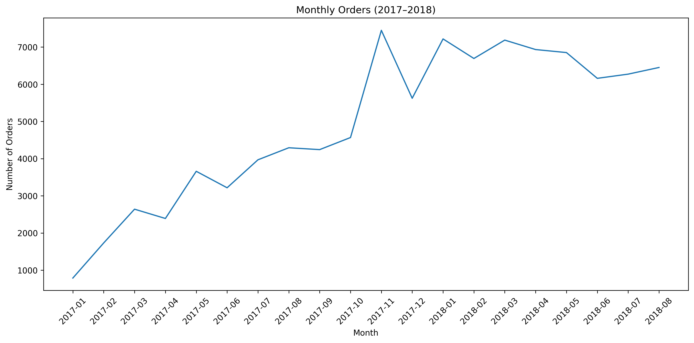
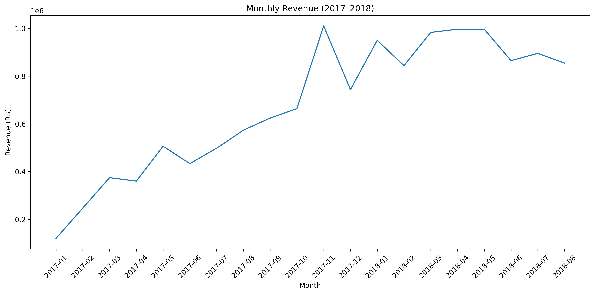

- Project Overview

This project analyses sales performance using the Olist Brazilian E-commerce Public Dataset. The aim is to identify monthly sales trends and understand how order volume relates to revenue.

- Tools Used

SQL (MySQL): Data quality checks, table joins, KPI calculations, monthly sales analysis, and month-over-month growth.

Python: Pandas for data handling and Matplotlib for data visualisation.

Jupyter Notebook: Python analysis and charts.

- Business Questions

What are the overall sales KPIs?

How did monthly revenue and order volume change over time?

Which months had the highest revenue?

How did revenue change compared with the previous month?

- Key Findings

Strong growth in 2017: Monthly revenue increased from approximately R$120,000 in January 2017 to over R$1 million in November 2017.

November 2017 was the peak month: Revenue reached R$1,010,271.37, with 7,451 orders.

Order volume contributed to the revenue peak: November's average product revenue per order was R$135.59, suggesting that the high revenue was largely associated with more orders rather than unusually high spending per order.

Sales remained strong in 2018: Monthly revenue was generally around R$840,000–R$1 million from January to August 2018.

- Visualisations

### Monthly Orders

### Monthly Revenue

- Project Structure

sql/ — SQL scripts for data quality checks and sales analysis.

python/ — Jupyter Notebook for visualisation.

visualisations/ — Exported charts.

.gitignore — Files excluded from version control.

- Limitations

The analysis focuses on three tables: orders, order items, and products.

Revenue refers to product prices and excludes freight unless otherwise stated.

Monthly summary results from SQL were transferred into Python for visualisation; Python does not connect directly to the MySQL database in this version.

The first and last months in the dataset contain very few orders and may represent incomplete periods, so the main trend analysis focuses on January 2017 to August 2018.

- Dataset

Olist Brazilian E-commerce Public Dataset, available on Kaggle.

Raw dataset files are not included in this repository.

- Conclusion

This project demonstrates the use of SQL for data validation and sales analysis, alongside Python for visualising business trends and communicating findings.